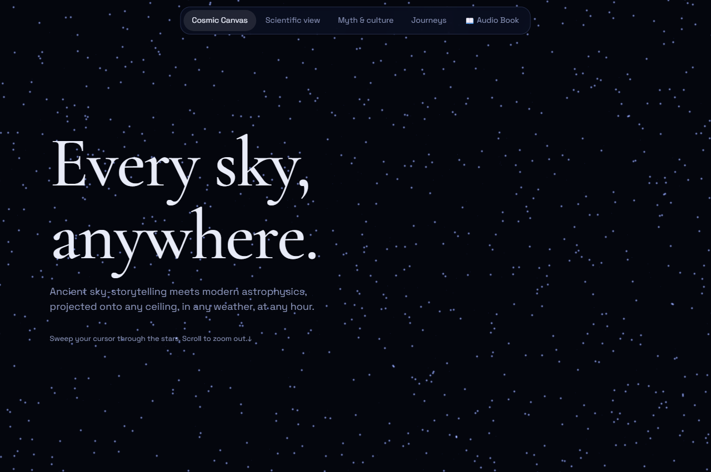
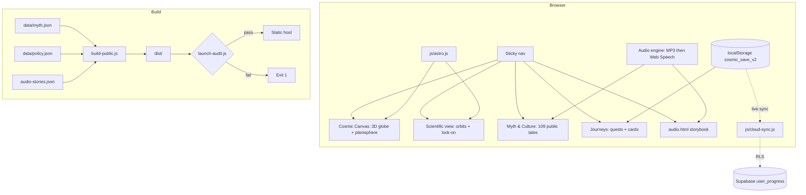

# 🌌 Cosmic Mythology AR Explorer

Real star positions (BSC5, Hipparcos, Gaia DR3) meet global celestial stories.
Zero-build static site: HTML5, vanilla JS (ES2020+), CSS3, Three.js r128 (self-hosted), and self-hosted Supabase ESM.

**Live Deployment:** [https://cosmos-one-opal.vercel.app](https://cosmos-one-opal.vercel.app)

The public site serves **109 stories across 7 verified traditions**. 3 living oral traditions (Polynesian, Indigenous Australian, and Indigenous Americas — 56 stories total) are held back in `data/myth.json` pending community review under `data/policy.json`.



## Principles
- **Client-side astrometry**: GMST, LST, hour angle and altitude computed in the browser via `js/astro.js`.
- **Local-first persistence**: local progress in `localStorage` (`cosmic_save_v2`), synced to cloud via Supabase.
- **Privacy by design**: no telemetry, no third-party CDNs, cultural-heritage filter for living oral traditions.
- **Supabase Cloud Sync (Live)**: Email password, magic link OTP, and OAuth redirects with non-destructive merge logic and Row-Level Security on `public.user_progress`.

## Quick start
```bash
# Local development
node scripts/serve.js                  # http://127.0.0.1:8000 (file:// breaks fetch)

# Validation and test suite
npm run check                          # Runs validate, test:astro, test, and test:build
npm run test:build                     # Tests public build integrity into a temp folder
npm test                               # Cloud sync merge and auth flow tests
npm run validate                       # Content and story schema validation

# Production public build
SITE_URL=https://cosmos-one-opal.vercel.app npm run build
```
Never edit `dist/` by hand; it is generated by `scripts/build-public.js`.

## Architecture


## Repository map
| Path | Role |
|---|---|
| `index.html` | Main app: globe, planisphere, science, myth, journeys |
| `audio.html` | Illuminated multilingual audio storybook |
| `js/astro.js` | GMST/LST/precession/alt-az math |
| `js/cloud-sync.js` | Supabase auth + progress sync (live) |
| `supabase/migrations/` | `user_progress` schema + RLS |
| `data/` | `myth.json`, `myth.public.json`, `policy.json`, `audio-stories.json`, `citation-audit.csv` |
| `scripts/` | `build-public.js`, `test-build-guard.js`, `launch-audit.js`, validators |
| `vendor/`, `assets/fonts/` | Self-hosted Three.js, Supabase ESM, and WOFF2 fonts |
| `docs/screenshots/` | Reference screenshots for key app views |

## Sky math
JD = ms/86400000 + 2440587.5; d = JD − 2451545.0  
GMST° = (18.697374558 + 24.06570982441908·d)·15 mod 360  
LST = GMST + λ (east-positive); HA = LST − RA  
sin(alt) = sin φ sin δ + cos φ cos δ cos HA  

## Gotchas
- `index.html` is a monolith; preserve script order.
- Keep Pointer Events (touch + mouse) on the globe and planisphere.
- Heritage filter strips `poly`, `ind`, `amer` stories (165 → 109) when `excludePendingCommunityReview` is true.
- `scripts/build-public.js` fails loudly if any expected transform does not match. Run `npm run test:build` after editing HTML.

## Cloud Sync & Auth
Supabase authentication and data syncing are live. Sessions are persisted in `localStorage['cosmos_active_session']` and progress is mirrored to PostgreSQL `public.user_progress` using non-destructive merge resolution (`mergeProgress`).
