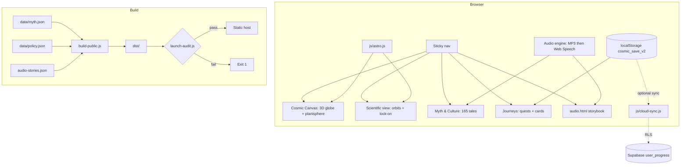

# 🌌 Cosmic Mythology AR Explorer

Real star positions (BSC5, Hipparcos, Gaia DR3) meet 165 celestial stories from 10 traditions.
Zero-build static site: HTML5, vanilla JS (ES2020+), CSS3, Three.js r128 (self-hosted). Works offline after first load.

## Principles
- **Client-side astrometry**: GMST, LST, hour angle and altitude computed in the browser.
- **Offline-first**: embedded datasets, Web Speech fallback, progress in `localStorage` (`cosmic_save_v2`).
- **Privacy by design**: no telemetry, no third-party CDNs, cultural-heritage filter for living oral traditions.

## Quick start
```bash
node scripts/serve.js                  # http://127.0.0.1:8000  (file:// breaks fetch)
node scripts/validate-content.js       # content/schema checks
SITE_URL=https://your-domain.org node scripts/build-public.js   # builds dist/ + launch audit
node scripts/check-ci.js               # policy exclusion check
```
Never edit `dist/`; it is regenerated on every build.

## Architecture


## Repository map
| Path | Role |
|---|---|
| `index.html` | Main app: globe, planisphere, science, myth, journeys |
| `audio.html` | Illuminated multilingual audio storybook |
| `js/astro.js` | GMST/LST/precession/alt-az math |
| `js/cloud-sync.js` | Supabase auth + progress sync (post-launch) |
| `supabase/migrations/` | `user_progress` schema + RLS |
| `data/` | `myth.json`, `myth.public.json`, `policy.json`, `audio-stories.json`, `citation-audit.csv` |
| `scripts/` | `serve.js`, `build-public.js`, `launch-audit.js`, validators |
| `vendor/`, `assets/fonts/` | Self-hosted Three.js, Supabase ESM, and WOFF2 fonts |

## Sky math
JD = ms/86400000 + 2440587.5; d = JD − 2451545.0
GMST° = (18.697374558 + 24.06570982441908·d)·15 mod 360
LST = GMST + λ (east-positive); HA = LST − RA
sin(alt) = sin φ sin δ + cos φ cos δ cos HA

## Gotchas
- `index.html` is a monolith; preserve script order.
- Keep Pointer Events (touch + mouse) on the globe and planisphere.
- Heritage filter strips `poly`, `ind`, `amer` stories (165 → 109) when `excludePendingCommunityReview` is true.

## Post-launch: Supabase
Run `supabase/migrations/001_user_progress.sql`, enable Email OTP + OAuth, self-host the supabase-js ESM build,
call `initCloud(url, anonKey)`, then `schedulePush()` after each local save.
